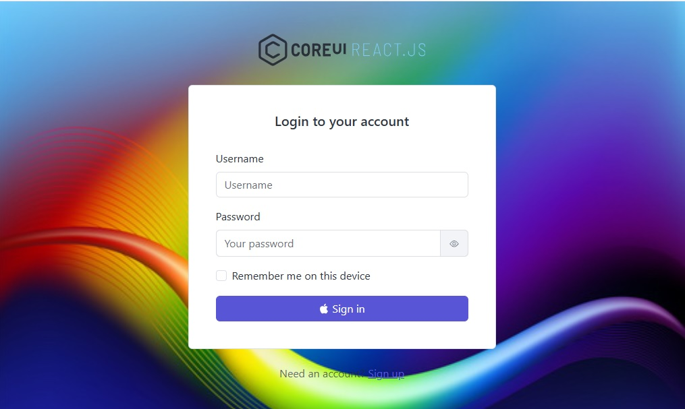
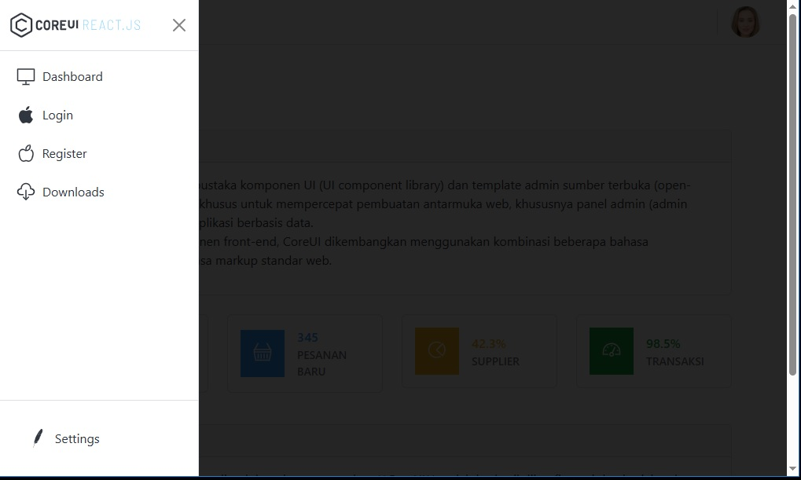
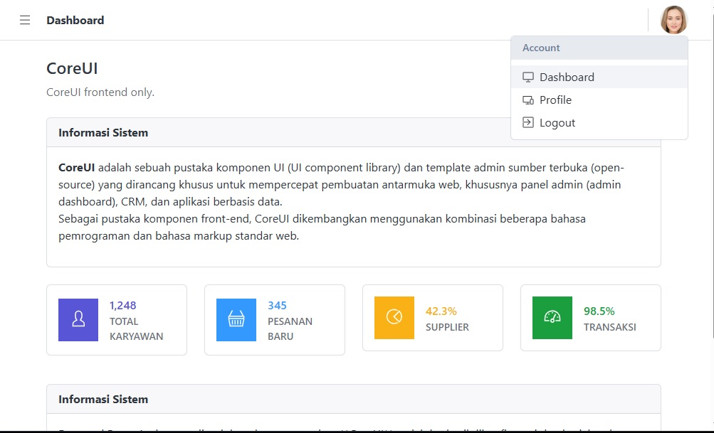

# 🚀 CoreUI Template - Frontend Only (Refactored)

Clean, production-ready frontend template refactored from CoreUI React.js.

This project is a decoupled frontend version of CoreUI, refactored to be easily integrated with any backend API (.NET Core, Laravel, Node.js).

### What was refactored?
- Removed backend dependencies & dummy data
- Cleaned up routing, layout, and auth pages (Login / Register)
- Separated UI components from business logic
- Ready to connect to REST API with JWT Auth

### Tech Stack
- React.js
- CoreUI + Bootstrap
- React Router

### Use Case
Perfect as a starter admin dashboard for enterprise applications. Just plug in your backend API and go.

### 📊 Capture 1

  

### 📊 Capture 2

  

### 📊 Capture 3

  

### 📊 Status

| Fitur / Modul | Status | Indikator |
| :--- | :---: | :---: |
| CoreUI  | `Terhubung` | 🌟 *Ready* |
| Axios  | `Terhubung` | 🌟 *Ready* |
| Koneksi MySQL  | `Tidak Ada` | 🌟 *NotReady* |
| RESTful API CRUD | `Tidak Ada` | 🌟 *NotReady* |
| Integrasi EF Core 9 | `Tidak Ada` | 🌟 *NotReady* |
| Database View (Raw SQL) | `Tidak Ada` | 🌟 *NotReady* |
| Koleksi Pengujian Bruno | `Tidak Ada` | 🌟 *NotReady* |
